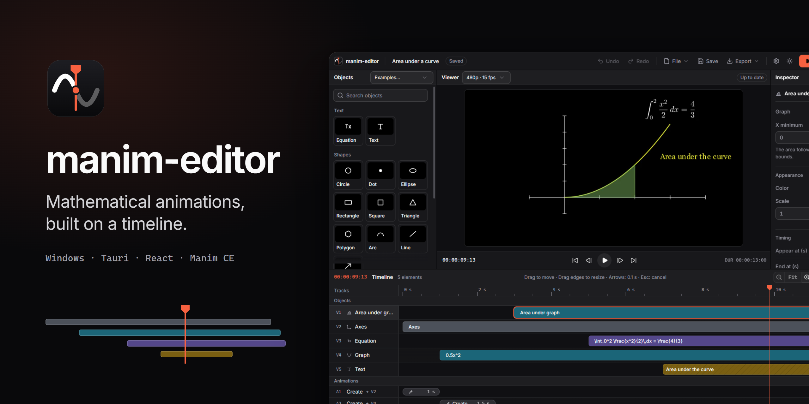
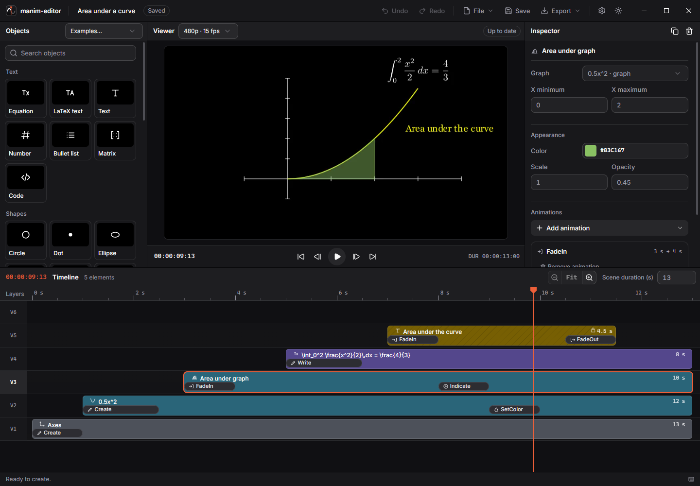
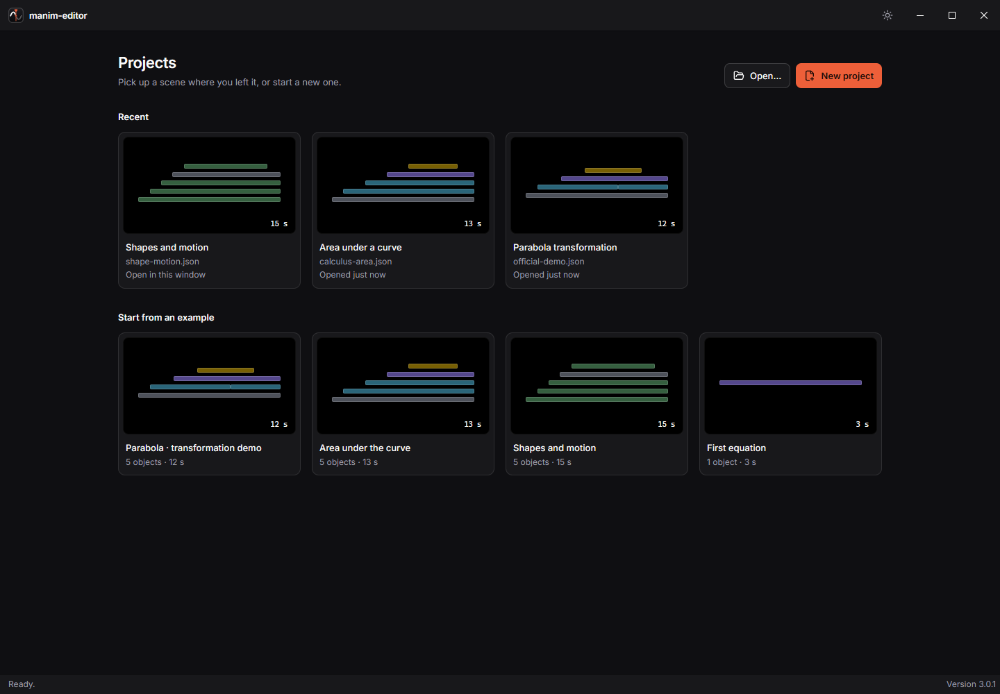
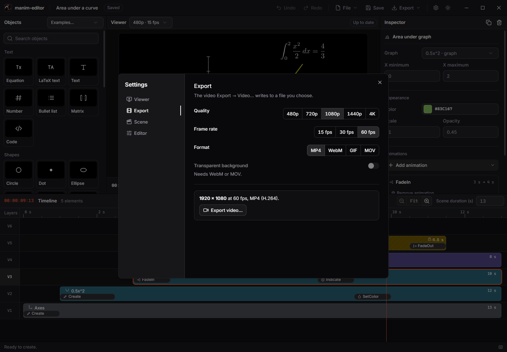
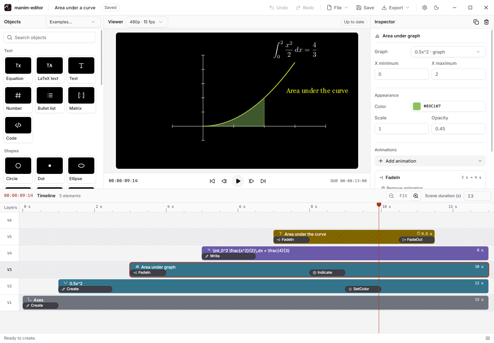
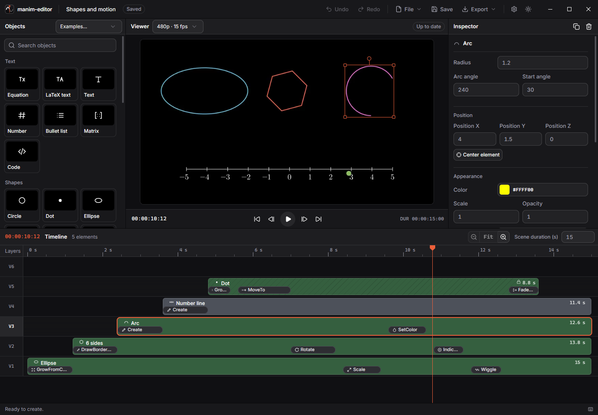
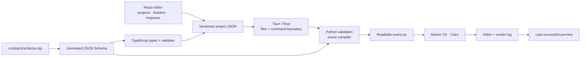

<!-- prettier-ignore -->
<div align="center">



[](https://github.com/diegormirhan/manim-editor/releases/latest)

[](src-tauri/)
[](src/app/)
[](src/domain/)
[](requirements.txt)

[Overview](#overview) • [Features](#features) • [Get started](#getting-started) • [Automation](#automate-it) • [How it works](#how-it-works) • [Updates](#publishing-an-update) • [Limitations](#known-limitations)

</div>

Build a graph, write its equation, shade an integral, and decide when each piece appears.
**manim-editor** turns those choices into a versioned project and readable [Manim](https://www.manim.community/)
Python, then renders a real video on your machine.

It is a Windows desktop editor for students and creators who already use Manim and want to spend
less time writing repetitive scene code.

> [!NOTE]
> This is a development MVP and an independent project, not an official Manim or 3Blue1Brown
> application. Rendering is local; nothing is sent to a server.

## Overview

A mathematical idea can be simple to sketch and tedious to translate into Python: find the right
class, remember its parameters, position the objects, sequence the animations, render, repeat.
manim-editor makes the supported part of that workflow visual. You still choose the mathematics,
the composition and the timing; Manim still produces every pixel.



*The real Tauri app showing its own Manim render. Between renders, the viewer shows Manim's own
frame at the playhead, live.*

Both demos below were built entirely in the editor, from the bundled [example projects](examples/):

| Area under a curve | Shapes and motion |
|---|---|
| [](docs/media/calculus-area.mp4) | [](docs/media/shape-motion.mp4) |
| Draw `f(x) = x² / 2`, reveal the area from 0 to 2, write the integral. 13 s · 854 × 480 · 15 fps | Build shapes and a number line, then move, rotate, scale, recolour and exit. 15 s · 854 × 480 · 15 fps |

The goal is less repetitive coding, not a faster renderer or complete Manim API coverage.
Time savings have not been measured in a user study.

## Features

- **A timeline like a video editor's.** The timeline is a stack of layers, V1 at the bottom, and
  higher layers draw on top. Each object is a clip on a layer and its animations ride inside it, so
  one row shows when an object is on screen and what it does. Drag a clip along its layer to move
  it, up or down to change layer, and its edges to resize it, with magnetic snapping to the playhead,
  the scene bounds and other clips. Drag the playhead from the ruler or by its line. Zoom with
  Ctrl+wheel; undo and redo everything.
- **Animations without typing times.** Choose one from **Add animation** in the inspector and it lands
  at the playhead, after whatever its object is already playing. Animations of different objects
  overlap freely; adjust them by dragging their clips. Adding an object never adds an animation for you.
- **Live preview.** While you edit or scrub, the viewer shows Manim's own frame at the playhead,
  usually within half a second, from a Manim process kept loaded in the background. A formula that
  will not compile says why, and the last good frame stays.
- **Arrange objects on the stage.** Drag an object in the viewer to place it, drag a corner of the
  selected one to scale it and its knob to turn it (Shift turns in 15° steps). Alignment guides snap
  it to the frame's centre and edges and to other objects, as in Canva; Alt drags freely. Each
  gesture undoes in one step, and arrow keys nudge the focused object.
- **Play renders for you.** Play renders the scene whenever the video is missing or out of date,
  reports Manim's progress, then plays it; Esc or the same button cancels. A failed render names its
  cause, such as the LaTeX error.
- **Your layout.** Drag the edges of the objects panel, the inspector and the timeline to resize them.
- **Export.** Video at 480p to 4K, 15, 30 or 60 fps, as MP4, WebM, GIF or MOV (transparent in WebM
  and MOV), or the same scene as readable Python.
- **Projects screen.** The app opens on your projects: the one you were working on, recent files
  with thumbnails drawn from their own timelines, and the bundled examples. Unsaved work survives a
  crash or a closed window.
- **Ready for scripts and AI agents.** A command line checks a project, draws any frame, renders
  the video and explains the format; see [Automate it](#automate-it).
- **A real desktop app.** Its own title bar with Windows 11 caption buttons, a short launch
  animation, light and dark themes that follow the system, and a signed in-app updater.



<details>
<summary>More screenshots</summary>







</details>

### What you can build

| Part of a scene | Available today |
|---|---|
| Text and notation | Text, LaTeX equations and text, numbers, bullet lists, matrices, code |
| Shapes | Circle, dot, ellipse, rectangle, rounded rectangle, square, triangle, regular polygon, star, ring, arc, sector |
| Lines | Line, dashed line, arrow, double arrow |
| Annotations | Braces with a label, highlight boxes, around any other object |
| Coordinates | Axes, number plane, number line |
| Graphs | Function graphs, areas under axis-linked graphs, bar charts |
| Entrances | Create, Write, FadeIn, GrowFromCenter, DrawBorderThenFill |
| Motion and appearance | MoveTo, Rotate, Scale, SetColor |
| Emphasis and exits | Indicate, Wiggle, FadeOut, Transform |
| Timing | Layers, and animations of different objects overlapping freely |

Every element accepts colour, scale and opacity; positioned elements also rotate.

> [!TIP]
> Graphs take mathematical notation, never Python: `sin(2x)/2`, `0.5x^2` or `(x - 2)^2 + 1`.
> TypeScript and Python share the same [expression fixtures](contracts/expression-cases.json), and an
> invalid expression points at its column.

## Getting started

### Prerequisites

- [Node.js](https://nodejs.org/) and npm (verified with Node 24).
- [Python](https://www.python.org/) 3.14 for the rendering environment.
- Rust with the MSVC toolchain, C++ build tools and WebView2: see
  [Tauri's Windows prerequisites](https://v2.tauri.app/start/prerequisites/).
- The system dependencies in [Manim's installation guide](https://docs.manim.community/en/stable/installation.html).
- A TeX distribution with `latex`, `dvisvgm` and Manim's template packages. The desktop bridge expects
  [TinyTeX](https://yihui.org/tinytex/) under `work/runtime/tex/TinyTeX/bin/windows`, which is not in Git.

### Install and run

From the repository root, in PowerShell:

```powershell
npm ci
python -m venv .venv
.\.venv\Scripts\python.exe -m pip install -r requirements.txt
npm run tauri -- dev
```

The app opens on **Projects**. Choose the **Area under the curve** example, then **Play**. To build
your own scene, choose **New project**, add an element, edit it, and add animations explicitly.

> [!TIP]
> `npm run dev` serves the whole interface at `http://127.0.0.1:1420` in any Chromium browser, with
> no Rust build. Only what needs the operating system (open, save, export, render) is unavailable,
> and it says so. Use this loop for UI work and the Tauri window for rendering and files.

## Automate it

A project is one JSON file, so a script or an AI agent can write a whole video as data. The command
line beside the app, `manim-editor-cli.cmd`, uses the editor's own validation and renderer, offline:

```powershell
.\manim-editor-cli.cmd guide                                      # the format, every element kind and its fields
.\manim-editor-cli.cmd check examples/calculus-area.json          # validate and summarise
.\manim-editor-cli.cmd frame examples/calculus-area.json --at 4   # Manim's frame at 4 s, and where each object sits
.\manim-editor-cli.cmd render examples/calculus-area.json -o area.mp4 --resolution 720p
.\manim-editor-cli.cmd python examples/calculus-area.json         # the generated Manim Python
```

An agent writes the project, runs `check` until it is valid, looks at a few frames, adjusts, and
renders. `manim-editor.exe scene.json` opens the result in the editor for a person to finish. The
whole guide is in [docs/automation.md](docs/automation.md); the render choices are listed once, in
[contracts/render-options.json](contracts/render-options.json).

## How it works

The editable project is **data, not Python source**. One versioned JSON document is the source of
truth; Python is a deterministic, one-way output.



| Boundary | Responsibility |
|---|---|
| [React interface](src/app/) | Projects screen, timeline gestures, inspectors, history, preview state |
| [UI components](src/components/ui/) | shadcn/ui (new-york, zinc) on Tailwind v4 and Radix, owned in the repo |
| [Domain layer](src/domain/) | Catalog, expression parsing, lifecycle validation, clip editing, settings |
| [Shared contract](contracts/) | Element and animation fields, render options; generates the persisted schema |
| [Rust shell](src-tauri/src/project_commands.rs) | Native dialogs, narrow commands, Python bridge, progress, cancellation |
| [Python renderer](renderer/manim_renderer/) | Validate again, compile deterministically, launch Manim, keep diagnostics |

Each render runs in an isolated directory holding the project snapshot, the generated source, the
log and the video, and only a successful result replaces the preview. The live preview compiles the
same scene in a Python process that keeps Manim loaded: it plays everything before the playhead to
its end, stops the running animation at the playhead and returns that single frame, with the box of each
object on screen; the viewer turns those boxes into drag handles. To add a feature, extend the
contract, the catalog or inspector and the focused compiler, then test both languages.

## Project structure

| Folder | What lives there |
|---|---|
| [`src/domain`](src/domain/) | The editor's rules in plain TypeScript: catalog, timeline, clip editing, validation |
| [`src/app`](src/app/) | The React interface: projects screen, stage, timeline, inspectors |
| [`src/components/ui`](src/components/ui/) | shadcn/ui components |
| [`src/infrastructure`](src/infrastructure/) | Calls into the desktop shell: files, renders, updates, the window |
| [`src/generated`](src/generated/) | Types and validator generated from the contract; never edited by hand |
| [`contracts`](contracts/) | The project format's single definition, and the render options |
| [`renderer`](renderer/) | Python: validation, the scene compiler, renders, live frames, the command line |
| [`src-tauri`](src-tauri/) | The Rust desktop shell: files, dialogs, the bridge to Python, updates |
| [`examples`](examples/) | The bundled example projects |
| [`tests/browser`](tests/browser/) | Playwright workflows against a simulated desktop |
| [`scripts`](scripts/) | Build, packaging, release and media scripts |
| [`docs`](docs/) | The automation guide, screenshots and demo media |

## Publishing an update

Installed copies read
`https://github.com/diegormirhan/manim-editor/releases/latest/download/latest.json` on every launch.
When it lists a newer version, a banner offers to download it; the installer's signature is checked
against the public key in [tauri.conf.json](src-tauri/tauri.conf.json) before it runs.

1. Raise `version` in [package.json](package.json); Tauri reads it from there.
2. Run `npm run build:installers`. It packs a Python that needs no installed Python
   ([prepare-runtime.ps1](scripts/prepare-runtime.ps1)), signs the installers with
   `%USERPROFILE%\.tauri\manim-editor.key` (or `TAURI_SIGNING_PRIVATE_KEY_PATH`) and writes
   `src-tauri/target/release/bundle/latest.json`.
   Add release notes with `npm run release:manifest -- --notes "What changed"`.
3. Optionally run `npm run build:portable`. Every download of the version then sits in
   `Releases/v<version>`, which Git ignores.
4. Create the GitHub release `v<version>` and attach the files in `Releases/v<version>`.

> [!WARNING]
> Keep a backup of the private key. Without it, installed copies can never be updated again; a new
> key pair means replacing `pubkey` and reinstalling by hand.

## Testing

```powershell
npm test                                                           # domain tests (Vitest)
npm run test:e2e                                                   # browser workflows (Playwright, Edge)
.\.venv\Scripts\python.exe -m unittest discover -s renderer/tests  # compiler, render runner, bridge
cargo test --manifest-path src-tauri/Cargo.toml                    # Rust bridge, includes a real render
```

| Check | Local result |
|---|---|
| Domain, Python and Rust tests | 61, 71 and 16 passing; Rust includes a real render, a cancelled render, a transparent MOV export, accented text surviving the trip through Python, a recent file reopened without a dialog, a project named at launch and live frames from one warm Manim worker |
| Browser workflows | 75 passing against a simulated desktop: projects, recent files, window controls, updates, live preview, layers, overlapping animations, the playhead's line, moving, scaling and turning on the stage, alignment guides, panel resizing, Play rendering, export, progress, settings |
| Exported formats (ffprobe) | 720p30 and 1080p60 H.264, GIF, VP9 with alpha, QuickTime Animation ARGB; a 15 s scene renders exactly 450 frames at 30 fps and 900 at 60 |
| The Tauri window | Real renders, Esc cancellation, LaTeX failures named, caption buttons, recent files saved in place, a tampered update refused, a signed one downloaded, verified and launched |

These are local results, not a CI badge or a clean-machine guarantee. The screenshots come from the
real app with fresh Manim renders, captured by [capture-readme.mjs](scripts/capture-readme.mjs); the
demo videos by [generate-demo-media.ps1](scripts/generate-demo-media.ps1).

## Known limitations

- One scene per project. Existing Manim Python cannot be imported, and exported Python is not read back.
- The live preview draws single frames, a few per second while you scrub; smooth playback needs a
  render. Its first frame waits for Manim to load (several seconds), and a new formula compiles its
  LaTeX once.
- Moving, scaling and turning on the stage need the live preview, since Manim reports where each
  object sits. Handles are upright bounding boxes, so a turned object shows the box around it, and a
  large object such as axes catches clicks across its whole box; smaller objects sit above it.
- Timing sits on a 15 fps grid, so exports use 15, 30 or 60 fps, and render progress advances once
  per finished Manim segment.
- An object plays one animation at a time, and two objects share a layer only when they take turns.
- The timeline cannot be exported to Premiere, DaVinci Resolve, Final Cut Pro or VEGAS; the video can.
- The downloads carry their own Python and load nothing from the build machine's, but a licence review
  of the bundled runtime, Authenticode signing and a test on a real clean machine are still pending.
  The portable zip does not update itself.
- Windows 11's Snap Layouts flyout does not open from the custom maximize button; Win+Z still works.

> [!IMPORTANT]
> The expression language excludes arbitrary Python, but the rendering stack is **not a sandbox**.
> Only open and render projects you trust, especially ones containing LaTeX.

## Resources

- [Manim Community documentation](https://docs.manim.community/)
- [Tauri 2 documentation](https://v2.tauri.app/) and its [updater plugin](https://v2.tauri.app/plugin/updater/)
- [shadcn/ui](https://ui.shadcn.com/), the component system the interface is built from
- [Example projects](examples/)
